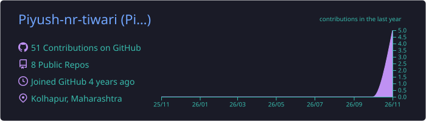
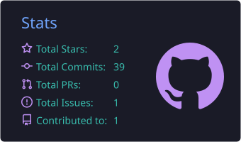
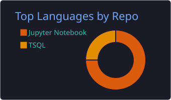
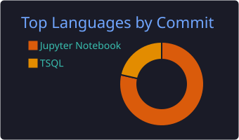

<!-- ===================== HEADER ===================== -->
<div align="center">


<a href="https://git.io/typing-svg"></a>

<br/>

<a href="https://ds-piyush-portfolio.lovable.app/"></a>
<a href="https://www.linkedin.com/in/piyushnrtiwari"></a>
<a href="mailto:piyush.nr.tiwari@gmail.com"></a>
<a href="https://medium.com/@piyush-nr-tiwari"></a>
<a href="https://www.hackerrank.com/piyush_nr_tiwari"></a>

<br/><br/>


</div>

<br/>

<!-- ===================== ABOUT ===================== -->
## 👋 &nbsp;About Me

```python
class Piyush:
    role       = "Program Manager – Data Science @ Parentof Solutions"
    experience = "4+ years · ML · GenAI · Computer Vision · Analytics"
    superpower = "Translating business needs into shipped AI products"
    stack      = ["Python", "SQL", "PyTorch", "Hugging Face", "YOLOv8", "DuckDB", "MongoDB"]
    languages  = ["English", "Hindi", "Marathi"]
    now        = "Building AI-powered assessment & recommendation systems"
    open_to    = "Collaborations in AI/ML, GenAI and data products"
```

<br/>

<!-- ===================== STATS STRIP ===================== -->
<div align="center">

| 🧠 **4+** | 🖼️ **2,000+** | 🏆 **3** | 📜 **10** |
|:---:|:---:|:---:|:---:|
| Years in Data & AI | Images in my CV training set | Company awards | Certifications |

</div>

<br/>

<!-- ===================== TECH STACK ===================== -->
## 🛠️ &nbsp;Tech Stack

<div align="center">


<br/><br/>


</div>

<br/>

<!-- ===================== PROJECTS ===================== -->
## 🚀 &nbsp;Featured Work

<table>
<tr>
<td width="50%" valign="top">

### 🎯 AI Assessment & Recommendation Platform
Assessment, reporting and curation ecosystem that fuses test results, gameplay data, behavioral indicators and skill mappings into automated reports and recommendations.

`Python` `SQL` `MongoDB` `DuckDB` `Pandas`

</td>
<td width="50%" valign="top">

### ✍️ Handwriting Analysis · Computer Vision
YOLOv8 instance-segmentation pipeline that scores handwriting quality across multiple criteria, trained on **2,000+ images**, with inference, scoring logic and downstream analytics.

`YOLOv8` `PyTorch` `Segmentation`

</td>
</tr>
<tr>
<td width="50%" valign="top">

### 🤖 NLP & LLM Automation
Prompt-driven workflows for automated data processing, classification, structured outputs and analysis using Transformers, DistilBERT and LLM APIs.

`Transformers` `DistilBERT` `LLM APIs`

</td>
<td width="50%" valign="top">

### 🎮 Game Analytics & Scoring
Scoring and analytics logic across multiple game types, linking gameplay events and attention-related behavior to assessment and skill-level data.

`Python` `Pandas` `NumPy`

</td>
</tr>
</table>

<br/>

<!-- ===================== EXPERIENCE ===================== -->
## 💼 &nbsp;Experience

| | Role | Company | Period |
|:-:|---|---|---|
| 🟣 | **Program Manager – Data Science** | Parentof Solutions | Mar 2026 → Present |
| 🔵 | **Senior Analyst – Data / AI** | eClerx Services | Jul 2024 → 2026 |
| 🟢 | **Data Scientist** | Parentof Solutions | Jan 2023 → Jun 2024 |
| ⚪ | **Accounting Analyst** | P N Joshi & Co | Nov 2018 → Apr 2020 |

<details>
<summary><b>🔍 &nbsp;What I did in each role</b></summary>
<br/>

**Program Manager – Data Science · Parentof Solutions**
- Lead cross-functional delivery across Data Science, Engineering, Product and business stakeholders
- Drive ML, GenAI, NLP, Computer Vision and recommendation-system initiatives
- Build pipelines and analytics workflows with Python, SQL, MongoDB, DuckDB, Pandas and NumPy
- Coordinate technical hiring for Data Analyst and Full Stack Engineering roles

**Senior Analyst – Data / AI · eClerx**
- Built and optimized data-processing workflows for large datasets
- Contributed to the ZEUS platform migration and re-engineered modules for GPU-based compute
- Contributed to Generative AI and AI automation initiatives
- 🏆 Values Award – Excellence · Super Achiever Award · Rising Star Award

**Data Scientist · Parentof Solutions**
- Built ML and NLP solutions for education and child-development products
- Worked on feature engineering, handwriting analysis and image segmentation
- Developed analytical logic for assessment, reporting, recommendation and curation workflows

</details>

<br/>

<!-- ===================== EDUCATION ===================== -->
## 🎓 &nbsp;Education & Certifications

<table>
<tr>
<td width="50%" valign="top">

**Education**
- 🎓 **PG Program, Data Analytics & Data Science** — Masai School *(2022)*
- 🎓 **B.Com** — Shivaji University *(2016 – 2019)*

**Recognition**
- 🥇 **Skill of the Year 2025 – Generative AI**, Technical University of Munich × eClerx
- 🏆 Values Award · Super Achiever · Rising Star, eClerx

</td>
<td width="50%" valign="top">

**Certifications**
- Data Analytics Virtual Experience — **Accenture**
- Data Science Tools — **IBM** & **Cognitive Class**
- Python 101 for Data Science — **Cognitive Class**
- Data Visualization using Tableau — **Great Learning**
- Introduction to R — **Great Learning**
- Introduction to Data Analytics — **Simplilearn**
- Master Data Management — **TCS iON**

</td>
</tr>
</table>

<br/>

<!-- ===================== GITHUB STATS ===================== -->
## 📊 &nbsp;GitHub Analytics

<div align="center">


<br/><br/>







<sub>Language charts reflect public code only, not experience or skill level.</sub>

</div>

<br/>

<!-- ===================== FOOTER ===================== -->
<div align="center">

### 📫 Let's build something together

<a href="mailto:piyush.nr.tiwari@gmail.com"></a>

<sub>⭐ If something here helped you, star a repo, it means a lot!</sub>


</div>
